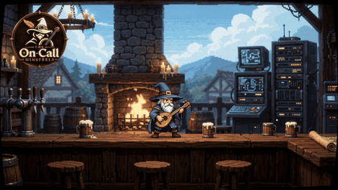

# The On-Call Minstrels

Seamless walking loop of the On-Call Minstrels gameplay clip.



| File | What it is |
| --- | --- |
| `video/walking_loop.mp4` | **Final loop**: 1280×720, 24 fps, 6.75 s, no audio. The last frame flows straight into the first. |
| `video/walking_loop.gif` | Lightweight preview of the same loop (420 px, 10 fps). |
| `video/walking_loop_hyperframes.mp4` | The same loop rendered by HyperFrames (frame-identical to the Remotion render). |
| `video/preview_loop_dissolve.mp4` | First preview (dissolve at the loop point). Kept for comparison. |
| `assets/source/gemini_generated_video.mp4` | Original clip generated with Gemini: title screen, level, fireworks. |

## How the loop works

In the original clip the camera only travels one way, from the fireplace to the map. The end
never matches the start. The loop is therefore a patrol:

1. **Walking right (original footage).** The wizard idles at the fireplace, walks right, jumps
   over the mugs and lands on the map. The score HUD is removed so every frame of the loop
   matches.
2. **Stop and turn.** The camera eases to a stop (virtual camera positions rendered from the
   depth maps), the wizard stops and turns around.
3. **Walking back.** The camera retraces its path. The wizard walks back as a mirrored sprite over
   reconstructed clean backgrounds and jumps over the same spots (time-reversed jumps).
4. **Arrival.** He stops at the fireplace and turns to face right, in the same idle pose that
   starts the loop.

The scene is a 2.5D side-scroller. The camera only translates. The back wall moves at 1×, the
counter the wizard walks on at ≈2.2×, and the stools at ≈2.5×. The pipeline uses this to
rebuild the background behind the wizard:

- camera path per frame (feature matching, sub-pixel);
- per-frame depth (parallax ratio) maps by plane sweep over neighbouring frames;
- wizard masks from "pixels no static depth can explain";
- clean plates: depth-based forward warping from other frames plus a median panorama of the
  back wall, with notes and sparkles excluded;
- RGBA sprites of the wizard with colours decontaminated against the clean plate.

## Project layout

```
remotion/               Remotion project: timeline.json + assets → WalkingLoop composition
hyperframes/            HyperFrames CLI (npm) and the walking-loop project (same timeline)
tools/loop_pipeline/    Python pipeline that builds every asset from the source clip
```

### Render with Remotion

```bash
cd remotion
npm install
npx remotion render WalkingLoop ../video/walking_loop.mp4
npx remotion studio            # inspect / tweak frame by frame
```

`remotion.config.ts` points Remotion to a local Chromium headless shell. Override it with
`REMOTION_BROWSER=/path/to/chrome-headless-shell`.

### Render with HyperFrames

```bash
cd hyperframes && npm install
export HYPERFRAMES_BROWSER_PATH=/path/to/chrome-headless-shell   # or: npx hyperframes browser ensure
cd walking-loop
npx hyperframes check
npx hyperframes render --fps 24 --output ../../video/walking_loop_hyperframes.mp4
```

`index.html` stacks two framework-owned video layers generated from `remotion/public/timeline.json`
by `tools/loop_pipeline/build_hyperframes.py`: `assets/loop_background.webm` (VP9) and
`assets/loop_wizard.webm` (VP9 with alpha). Edit the timeline, not the HTML. The layers are VP9
because open-source Chromium cannot decode H.264 in preview. `npx hyperframes check` passes with
0 errors and 0 warnings.

### Rebuild all assets from the source clip

```bash
pip install -r tools/loop_pipeline/requirements.txt   # plus ffmpeg on PATH
tools/loop_pipeline/run_pipeline.sh                    # ~30–40 min on 4 CPU cores
```
